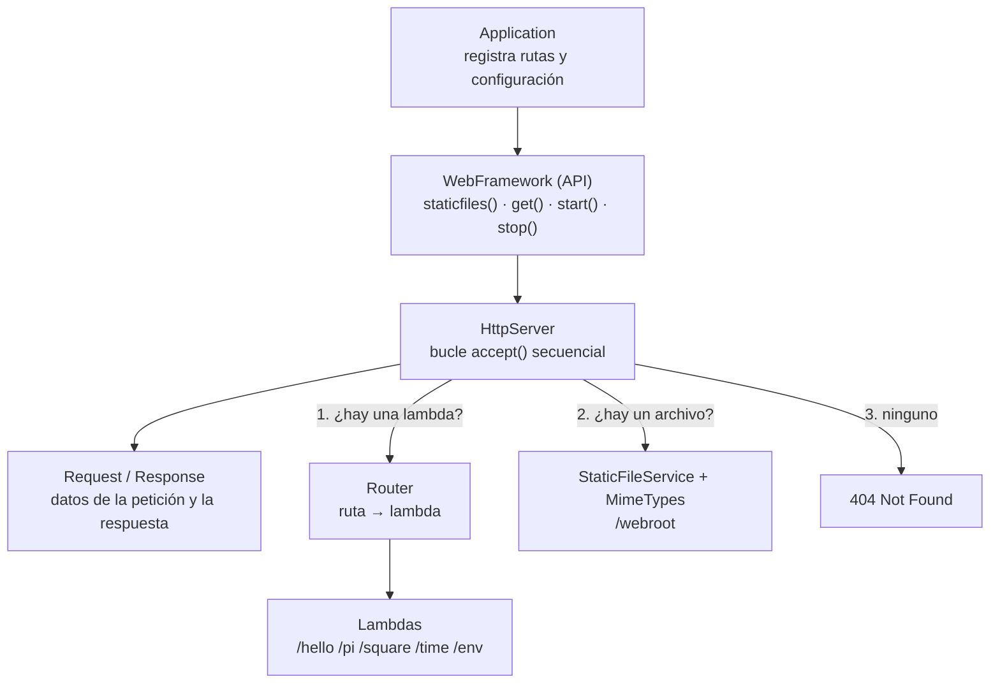
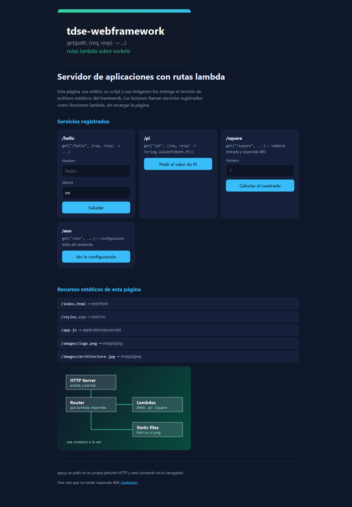
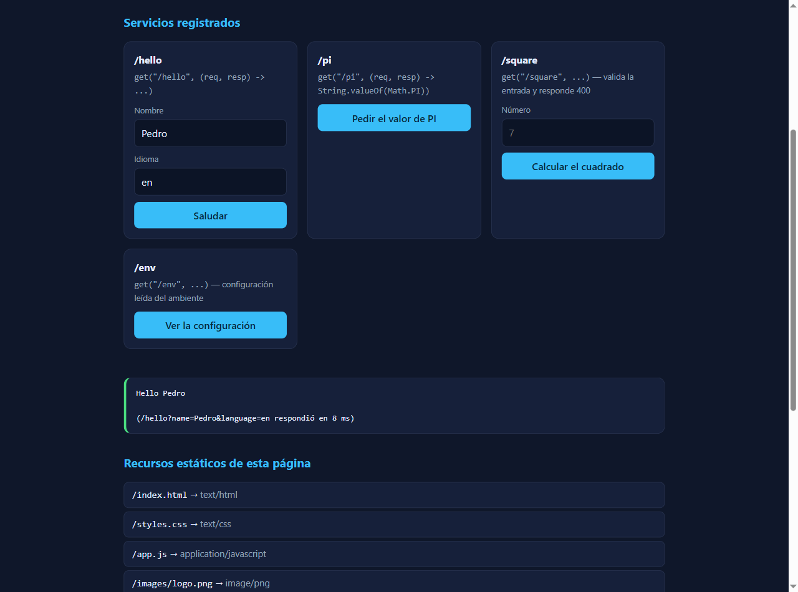
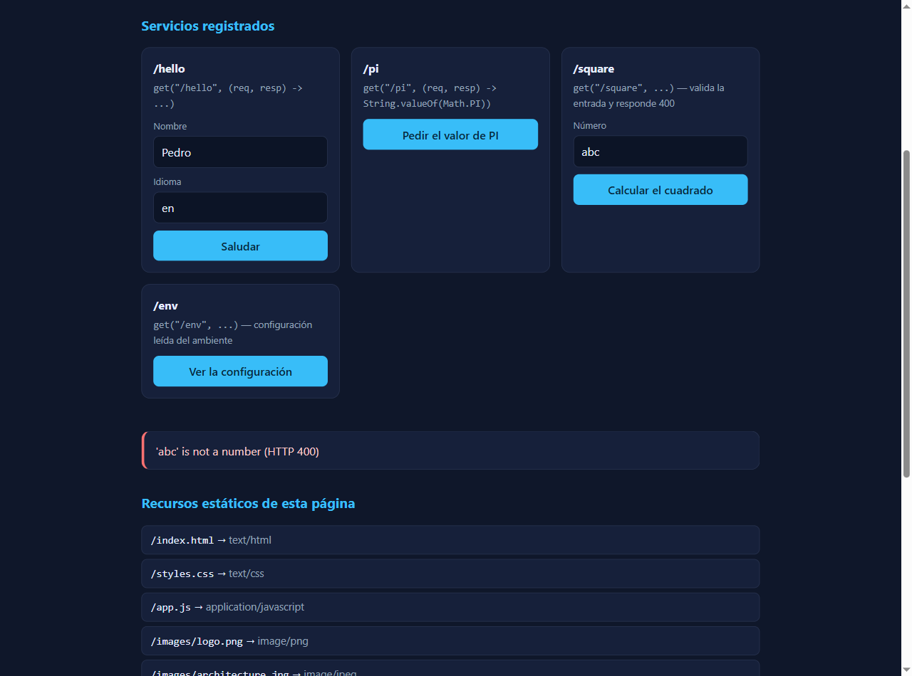
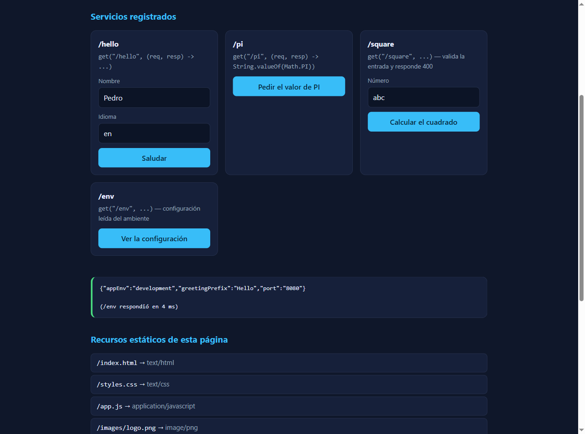
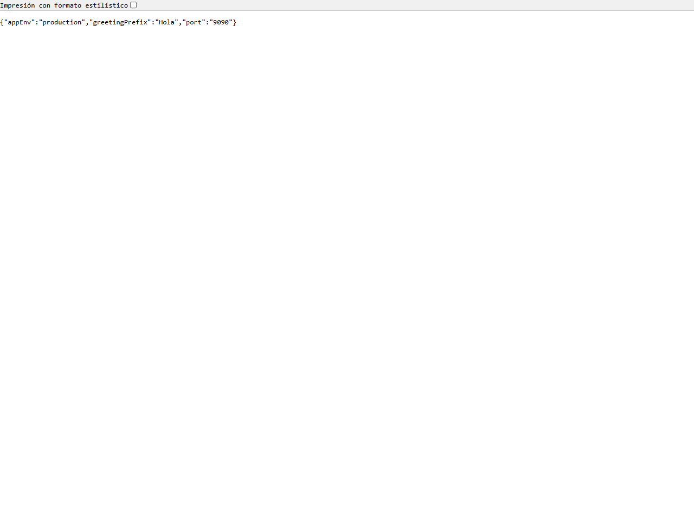

# tdse-webframework — Servidor de aplicaciones con rutas lambda

Framework web mínimo escrito en Java sobre sockets, sin dependencias de
ejecución, y una aplicación de ejemplo que lo usa. El desarrollador registra sus
servicios con funciones lambda y nunca toca el bucle de conexiones:

```java
import static co.edu.escuelaing.webframework.WebFramework.*;

public class Application {
    public static void main(String[] args) throws Exception {
        staticfiles("/webroot");

        get("/hello", (req, resp) -> {
            String name = req.getValue("name");
            return "Hello " + (name == null || name.isBlank() ? "world" : name);
        });

        get("/pi", (req, resp) -> String.valueOf(Math.PI));

        start();
    }
}
```

Este laboratorio parte del servidor HTTP secuencial del taller anterior, donde
cada ruta nueva era otro `if` dentro del bucle de conexiones, y lo convierte en
un pequeño servidor de aplicaciones: la infraestructura HTTP queda separada del
comportamiento de la aplicación, la configuración sale del código y el servidor
se puede apagar de forma ordenada.

El servidor sigue siendo **secuencial**: atiende una conexión a la vez. La
concurrencia queda fuera del alcance de este taller.

| | |
|---|---|
| Lenguaje | Java 17+ |
| Build | Maven |
| Dependencias de ejecución | ninguna |
| Dependencias de prueba | JUnit 5 |
| Puerto por defecto | 8080 (`PORT`) |
| Empaquetado | un `.jar` ejecutable, con la página adentro |
| Contenedor | `Dockerfile` multi-etapa incluido |

---

## Metáfora de la arquitectura: el edificio de oficinas

Para entender cómo colaboran las partes sirve pensar en un edificio que atiende
público:

| En el edificio | En el sistema | Archivo |
|---|---|---|
| **La portería**, con un portero que recibe a cada visitante, mira la solicitud que trae y le entrega la respuesta | **HTTP Server**: acepta la conexión, lee la petición y escribe la respuesta | [HttpServer.java](src/main/java/co/edu/escuelaing/webframework/HttpServer.java) |
| **El directorio del lobby**, que dice qué oficina atiende cada trámite | **Router**: sabe qué lambda responde cada ruta | [Router.java](src/main/java/co/edu/escuelaing/webframework/Router.java) |
| **Las oficinas**, cada una con su propio trámite | **Lambdas**: `/hello`, `/pi`, `/square`, `/time`, `/env` | [Application.java](src/main/java/co/edu/escuelaing/app/Application.java) |
| **El archivo**, con los documentos ya impresos | **Static File Service**: entrega HTML, CSS, JavaScript e imágenes | [StaticFileService.java](src/main/java/co/edu/escuelaing/webframework/StaticFileService.java) |
| **El formulario que llena el visitante** y **el recibo que se lleva** | **Request** y **Response** | [Request.java](src/main/java/co/edu/escuelaing/webframework/Request.java), [Response.java](src/main/java/co/edu/escuelaing/webframework/Response.java) |
| **El reglamento del edificio**: horario, piso, nombre en la puerta | **Variables de ambiente**: `PORT`, `APP_ENV`, `GREETING_PREFIX`, `STATIC_FILES_PATH` | — |
| **El procedimiento de cierre**: se termina de atender al visitante que está en la ventanilla, se le entrega su documento, y solo entonces se cierra la puerta | **Apagado ordenado**: `/shutdown` apaga la bandera, la respuesta se envía completa y después termina el bucle | [WebFramework.stop()](src/main/java/co/edu/escuelaing/webframework/WebFramework.java) |

Lo importante de la metáfora: **abrir una oficina nueva no obliga a cambiar al
portero**. Antes, agregar `/pi` significaba meter otro `if` en el bucle de
sockets; ahora significa registrar una función en el directorio.

## Arquitectura



Orden de resolución de cada petición:

```
Llega la petición
        ↓
Se parsean método, ruta y query string
        ↓
¿Hay una ruta registrada?  → sí → se ejecuta su lambda
        ↓ no
¿Hay un recurso estático?  → sí → se entrega el archivo
        ↓ no
404 Not Found
```

### Responsabilidad de cada componente

| Componente | Responsabilidad |
|---|---|
| `Application` | Solo configuración: dice dónde están los archivos estáticos y qué lambda atiende cada ruta. No ve un socket. |
| `WebFramework` | La API pública: `staticfiles()`, `get()`, `start()`, `stop()`. Es una fachada delgada sobre un `HttpServer`. |
| `HttpServer` | Abre el socket, acepta conexiones una por una, lee la petición, pregunta al router, y escribe la respuesta. No sabe qué hace ninguna ruta. |
| `Router` | Guarda las rutas registradas y encuentra la que corresponde a un método y una ruta. |
| `Route` / `RouteHandler` | Una ruta registrada y la interfaz funcional que permite que sea una lambda. |
| `Request` | Método, ruta y valores del query string. `getValue("name")` devuelve `null` si el parámetro no vino. |
| `Response` | Estado, encabezados y cuerpo en bytes. Un handler puede cambiar el estado o el tipo de contenido. |
| `StaticFileService` | Busca el archivo dentro de `/webroot` (en el jar) o en la carpeta de `STATIC_FILES_PATH`, y rechaza rutas inseguras. |
| `MimeTypes` | Extensión → `Content-Type`. |

## Por qué esta arquitectura es mantenible

Lo que la hace mantenible no es usar lambdas: es que **lo que cambia seguido
quedó separado de lo que casi nunca cambia**.

| Principio | Cómo se aplica aquí |
|---|---|
| Separación de responsabilidades | El manejo de sockets y de HTTP está en el framework; el comportamiento del negocio está en `Application`. |
| Modularidad | Router, parseo, archivos estáticos y servicios son componentes distintos. |
| Bajo acoplamiento | Agregar `/square` no cambió una línea de `HttpServer`. |
| Alta cohesión | Cada clase tiene una sola razón para cambiar. |
| Abstracción | La aplicación usa `get()` y `staticfiles()` y nunca ve un `ServerSocket`. |
| Configuración externa | Puerto, prefijo del saludo y ambiente vienen de variables; el mismo `.jar` corre local y en la nube. |
| Extensibilidad | Un servicio nuevo es una función registrada, no una modificación del servidor. |
| Testabilidad | El router, el parseo y cada lambda se prueban por separado, sin levantar el servidor. |

Antes y después:

```
Antes                                  Después
HTTP Server                            HTTP Server → Router → Lambdas
  ├── sockets                            │                  ├── /hello
  ├── parseo HTTP                        │                  ├── /pi
  ├── archivos estáticos                 │                  └── nuevos servicios
  ├── implementación de /hello           │
  ├── implementación de /pi              └── Static File Service
  └── toda ruta futura
```

---

## Estructura del proyecto

```
Building-and-Deploying-a-Maintainable-Application-Server/
├── pom.xml
├── Dockerfile                     Imagen multi-etapa para desplegar en la nube
├── README.md
├── docs/
│   ├── EVIDENCE.md                Pruebas y resultados observados
│   ├── local-evidence.txt         Transcripción de curl
│   ├── network-requests.txt       Peticiones vistas en el navegador
│   └── img/                       Capturas
├── src/main/java/co/edu/escuelaing/
│   ├── webframework/
│   │   ├── WebFramework.java      API: staticfiles, get, start, stop
│   │   ├── HttpServer.java        Bucle secuencial y orden de resolución
│   │   ├── Router.java            Ruta → lambda
│   │   ├── Route.java             Una ruta registrada
│   │   ├── RouteHandler.java      Interfaz funcional del handler
│   │   ├── Request.java           Petición y valores del query
│   │   ├── Response.java          Respuesta (estado, tipo, bytes)
│   │   ├── StaticFileService.java Archivos estáticos y rutas seguras
│   │   ├── MimeTypes.java         Extensión → Content-Type
│   │   └── BadRequestException.java
│   └── app/
│       └── Application.java       La aplicación de ejemplo
├── src/main/resources/webroot/
│   ├── index.html
│   ├── styles.css
│   ├── app.js
│   └── images/{logo.png, architecture.jpg, favicon.png}
└── src/test/java/co/edu/escuelaing/webframework/
    ├── ServerIntegrationTest.java
    ├── RequestTest.java
    ├── RouterTest.java
    ├── StaticFileServiceTest.java
    └── WebFrameworkTest.java
```

## Prerrequisitos

* JDK 17 o superior
* Maven 3.8 o superior
* Opcional: Docker, para la imagen del despliegue

## Construcción y ejecución local

```bash
git clone https://github.com/brandoeci/Building-and-Deploying-a-Maintainable-Application-Server.git
cd Building-and-Deploying-a-Maintainable-Application-Server

mvn clean package           # compila, corre las 37 pruebas y empaqueta
java -jar target/tdse-webframework.jar
```

Al arrancar imprime:

```
APP_ENV=development: /shutdown is enabled
tdse-webframework listening on http://0.0.0.0:8080
Static files: classpath:/webroot/
Routes: 6 registered, sequential mode
```

La aplicación queda en <http://localhost:8080/>.

Para apagarla de forma ordenada, desde el navegador o la terminal:

```bash
curl http://localhost:8080/shutdown
```

Otras formas de arrancar:

```bash
PORT=9090 java -jar target/tdse-webframework.jar                    # otro puerto
GREETING_PREFIX="Buen día" java -jar target/tdse-webframework.jar   # otro saludo
APP_ENV=production java -jar target/tdse-webframework.jar           # sin /shutdown
mvn compile exec:java -Dexec.mainClass=co.edu.escuelaing.app.Application
```

## Variables de ambiente

Ninguna configuración que cambie entre ambientes está escrita en el código.

| Variable | Para qué sirve | Valor local | Valor en la nube |
|---|---|---|---|
| `PORT` | Puerto en el que escucha el servidor | `8080` | el que asigne la plataforma |
| `APP_ENV` | Ambiente de ejecución. Solo en `development` se registra `/shutdown` | `development` | `production` |
| `GREETING_PREFIX` | Texto con el que responde `/hello` | `Hello` | el que se quiera |
| `STATIC_FILES_PATH` | Carpeta externa con los archivos estáticos; si no está, se usan los del `.jar` | sin definir | sin definir |

Ninguna de estas variables es un secreto. En el repositorio no hay
credenciales, llaves ni tokens, y el `.gitignore` excluye `.env`, `*.pem`,
`*.key` y `.aws/`.

## Cómo se usa la aplicación

La página de inicio llama los servicios con `fetch()` y no se recarga nunca.

### Recursos estáticos

| URL | Tipo |
|---|---|
| `http://localhost:8080/` | `text/html` |
| `http://localhost:8080/index.html` | `text/html` |
| `http://localhost:8080/styles.css` | `text/css` |
| `http://localhost:8080/app.js` | `application/javascript` |
| `http://localhost:8080/images/logo.png` | `image/png` |
| `http://localhost:8080/images/architecture.jpg` | `image/jpeg` |

### Servicios registrados con lambda

| URL | Respuesta |
|---|---|
| `http://localhost:8080/hello` | `Hello world` |
| `http://localhost:8080/hello?name=Pedro` | `Hello Pedro` |
| `http://localhost:8080/hello?name=Pedro&language=es` | `Hola Pedro` |
| `http://localhost:8080/pi` | `3.141592653589793` |
| `http://localhost:8080/square?value=7` | `7 squared is 49` |
| `http://localhost:8080/square?value=abc` | `400` con `'abc' is not a number` |
| `http://localhost:8080/time` | `{"time":"...","zone":"America/Bogota"}` |
| `http://localhost:8080/env` | `{"appEnv":"development","greetingPrefix":"Hello","port":"8080"}` |
| `http://localhost:8080/shutdown` | Apaga el servidor (solo en desarrollo) |
| `http://localhost:8080/unknown` | `404 Not Found` |

Comportamiento ante errores:

| Caso | Resultado |
|---|---|
| Ruta que no existe y tampoco es un archivo | `404 Not Found` en `text/plain` |
| Parámetro que falta | No falla: `getValue()` devuelve `null` y la lambda decide (`/hello` responde `Hello world`) |
| Parámetro inválido | La lambda responde `400` con un mensaje claro |
| Método distinto de GET | `405` con `Allow: GET` |
| Ruta con `..` o archivos ocultos | `403`, sin entregar nada de fuera de `/webroot` |
| Petición malformada | `400` y el servidor sigue atendiendo |
| Lambda que lanza una excepción | `500` y el servidor sigue atendiendo |

## Cómo correr las pruebas

```bash
mvn test
```

37 pruebas en cinco clases (detalle en [docs/EVIDENCE.md](docs/EVIDENCE.md)).
Incluyen el apagado ordenado, el 404, la imagen byte a byte y la lambda que
falla sin tumbar el servidor.

---

## Despliegue en la nube

> **Estado:** el `Dockerfile` y el procedimiento están listos y el mismo
> artefacto se verificó localmente en modo `production` (puerto tomado de
> `PORT`, `/shutdown` no registrado). El despliegue público queda pendiente de
> la cuenta de AWS del curso, que no tiene créditos disponibles. La URL pública
> se agrega aquí cuando la cuenta esté habilitada.
>
> **URL pública:** _pendiente_

**Plataforma escogida:** AWS (EC2 con Docker, o App Runner a partir de la
imagen). La aplicación no cambia: escucha en todas las interfaces y toma el
puerto del ambiente.

### Con contenedor

```bash
docker build -t tdse-webframework .

docker run --rm -p 8080:8080 \
  -e PORT=8080 \
  -e APP_ENV=production \
  -e GREETING_PREFIX="Hola" \
  tdse-webframework
```

### En una instancia EC2

1. Lanzar una instancia Linux pequeña, con un security group que permita SSH
   desde la IP propia y TCP en el puerto de la aplicación.
2. Copiar el artefacto (o construir la imagen en la instancia):
   ```bash
   scp -i <llave.pem> target/tdse-webframework.jar ec2-user@<dns-publico>:~
   ```
3. Instalar el runtime y arrancar con las variables del ambiente de producción:
   ```bash
   sudo dnf install -y java-17-amazon-corretto-headless
   PORT=8080 APP_ENV=production GREETING_PREFIX="Hola" \
     nohup java -jar tdse-webframework.jar > server.log 2>&1 &
   ```
4. Verificar desde adentro de la instancia antes de probar desde afuera:
   ```bash
   curl localhost:8080/pi
   curl -i localhost:8080/shutdown    # debe responder 404 en producción
   ```
5. Abrir `http://<dns-publico>:8080/` en el navegador.

Al terminar la demostración: apagar la aplicación, **terminar la instancia**,
liberar la IP elástica si se creó y borrar el security group del laboratorio.

## Evidencias

Todas las capturas están en [docs/img/](docs/img) y la transcripción completa en
[docs/local-evidence.txt](docs/local-evidence.txt).

| Evidencia | Captura |
|---|---|
| La página desplegada, con sus imágenes y su script |  |
| Servicio `/hello?name=Pedro`, sin recargar la página |  |
| Servicio `/pi` |  |
| Entrada inválida: el `400` del servicio se vuelve un mensaje |  |
| Configuración leída del ambiente, en desarrollo |  |
| Ruta desconocida → `404 Not Found` |  |
| Variables de ambiente en producción: `PORT=9090`, `APP_ENV=production` |  |
| `/shutdown` **no** existe en producción |  |

Recursos pedidos al cargar **una sola** página
([docs/network-requests.txt](docs/network-requests.txt)):

```
GET /                          200  text/html
GET /styles.css                200  text/css
GET /images/logo.png           200  image/png
GET /images/architecture.jpg   200  image/jpeg
GET /app.js                    200  application/javascript
GET /images/favicon.png        200  image/png
```

Apagado ordenado en desarrollo:

```
$ curl -i http://localhost:8080/shutdown
HTTP/1.1 200 OK
Content-Length: 37

Server will stop after this response.

# log del servidor
GET /shutdown -> 200 text/plain; charset=utf-8 (37 bytes, 0 ms)
Server stopped gracefully.
```

En producción la misma URL responde:

```
$ APP_ENV=production ... $ curl -i http://localhost:9090/shutdown
HTTP/1.1 404 Not Found
404 Not Found
```

## Limitaciones conocidas

* **Secuencial**: una conexión a la vez, sin hilos ni pool. Está fuera del
  alcance de este taller.
* Solo se soporta **GET**; no hay `post()`, ni cuerpo de petición, ni rutas con
  variables (`/user/{id}`).
* No hay conexiones persistentes, compresión, caché condicional ni HTTPS.
* No hay sesión, base de datos ni autenticación.
* `/shutdown` apaga el proceso sin autenticación, por eso solo existe en
  desarrollo.

## Autor

**Hildebrando Peña Quezada** — Escuela Colombiana de Ingeniería Julio Garavito,
Taller de Desarrollo de Software Empresarial (TDSE).
GitHub: [@brandoeci](https://github.com/brandoeci)
